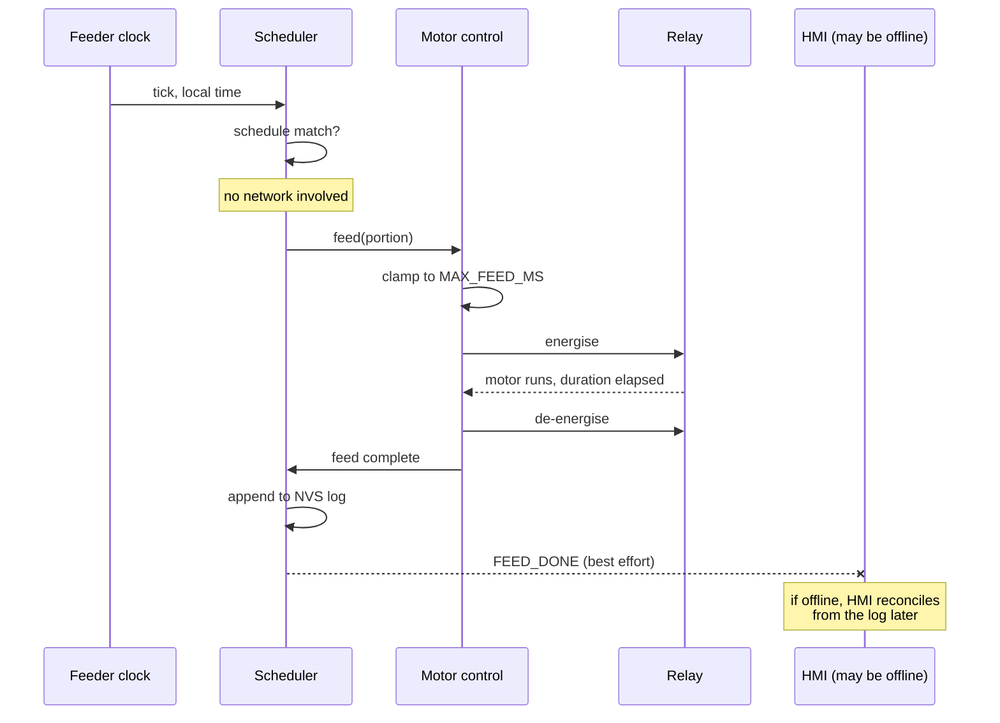
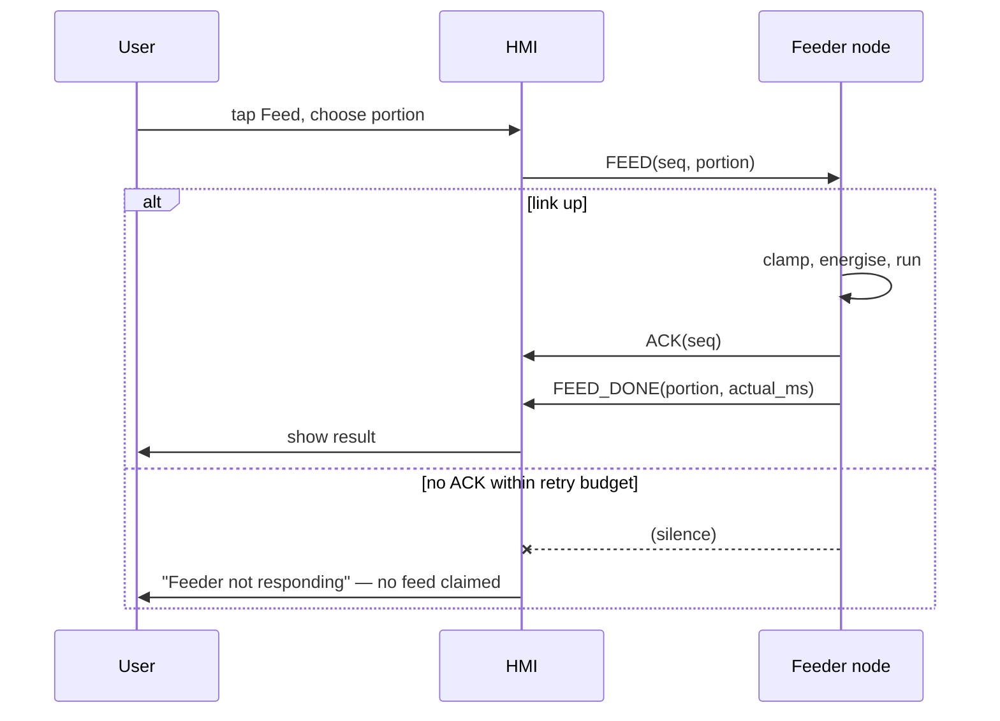
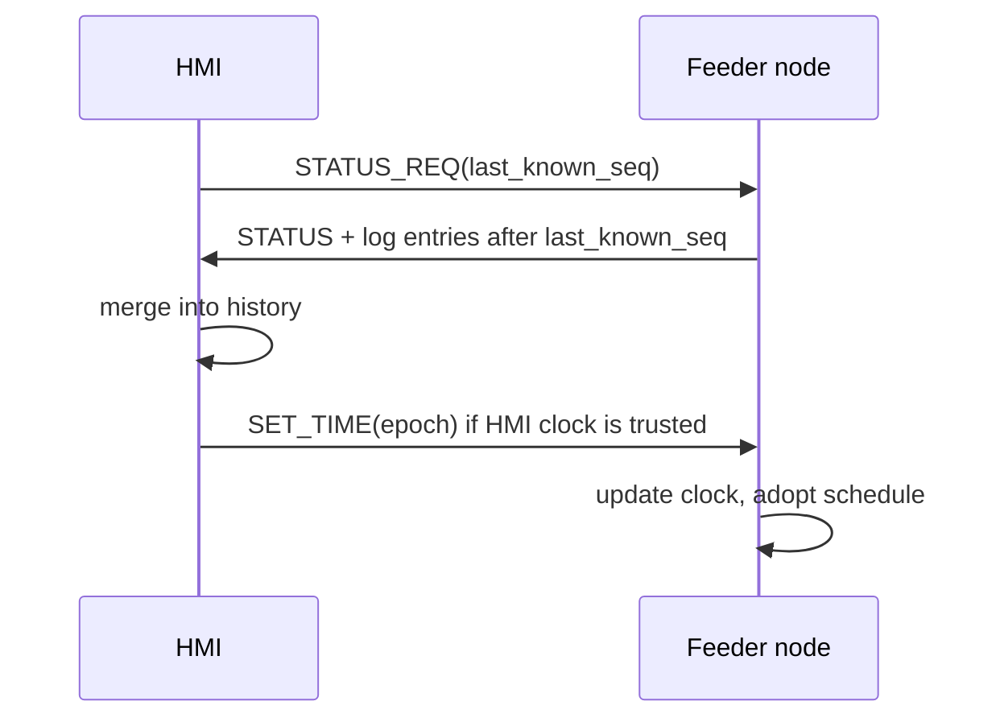

# 01 — Architecture

## In one paragraph

Two nodes. The **HMI** is a wall-mounted 4.3" touchscreen that lets a human describe what they want
— when to feed, how much, and what happened. The **feeder node** is an ESP32 next to the tank that
actually switches the motor, and that keeps feeding correctly when nobody is talking to it. They
speak ESP-NOW over 2.4 GHz, peer to peer, with no router in between. The split is not stylistic; it
is forced by the S3 board's pin budget and by the fact that a feeder must survive its network
dying.

## Design rules

These five outrank convenience. Everything else in the docs assumes them. Violating one is a bug,
not a trade-off.

### 1. The feeder node is autonomous

The feeder node stores the schedule in NVS and feeds on its own clock. The HMI is for **configuration
and override**, never a required hop for a scheduled feed.

*Why:* every dependency you add between "the time is 08:00" and "the motor turns" is a way for fish
to go unfed. A router reboot, a WiFi band change, a phone hotspot that stopped — none of these should
affect dinner. If the HMI is unplugged for a month, the feeder keeps working and the HMI simply has
stale history to reconcile when it returns.

*Consequence:* the schedule lives on the feeder node and the HMI holds a cached copy. On reconnect
they reconcile — the HMI is a view, the feeder node is the record. When they disagree, the feeder node
wins.

### 2. The relay is fail-safe by construction

De-energised means motor off. A **hard-coded maximum energised duration** is enforced below the
command layer, so no malformed command, hung task, or reboot can run the motor indefinitely.

*Why:* an overfeeding failure kills a tank faster than underfeeding. The failure mode that matters is
not "the feed didn't happen" but "the auger ran all afternoon".

*Consequence:* the duration clamp is a constant in the feeder firmware, not a configurable value, and
the function that actuates the relay refuses any duration beyond it. This is the one place where a
sanity limit is deliberately not exposed to the UI.

### 3. Time discipline

The feeder node syncs via SNTP when the network is available, holds over on the ESP32 internal RTC,
and accepts a time push from the HMI's PCF85063A. A DS3231 module is recommended for battery-backed
holdover.

*Why:* the ESP32 internal RTC does not survive a power cut. Without holdover, a power blip at 03:00
means the node wakes up believing it is 1970 and the day's schedule is silently lost. This is the
failure that destroys the schedule without any error surfacing anywhere.

*Consequence:* the feeder node tracks how confident it is in its own clock, and a node that has not
synced since boot says so in its status packet. The HMI surfaces that as a warning rather than
pretending all is well.

### 4. Motor power is separate from logic power

The relay coil runs on its own 5 V rail. The motor runs on its own supply, sized for inrush current.
Grounds are common. A DC motor gets a flyback diode; an AC motor gets an RC snubber. The board's 5 V
pin never feeds a motor.

*Why:* a stalled or starting motor pulls a large inrush that will brown out the ESP32 mid-feed —
producing exactly the reset-during-actuation scenario rule 2 guards against. Electrical noise from an
inductive load also corrupts the logic supply and causes random resets.

*Consequence:* see [02-hardware-and-wiring.md](02-hardware-and-wiring.md) for the power tree and the
wiring diagram.

### 5. Switching stays away from the display board

The relay is driven by the ESP32, not by the S3 board.

*Why:* two reasons, either one sufficient. **Pins:** the S3 board has none free — see below.
**Noise and current:** the motor's switching transients and high current belong next to the motor, on
a board with spare GPIO and no sensitive RGB display timing to disturb.

## Why the relay is not on the S3 board

Every GPIO on the ESP32-S3-Touch-LCD-4.3B is committed. This is verified from the vendor package, not
assumed.

| Consumer | Count | GPIOs |
| --- | --- | --- |
| RGB LCD, 16-bit parallel | 20 | 0, 1, 2, 3, 5, 7, 10, 14, 17, 18, 21, 38, 39, 40, 41, 42, 45, 46, 47, 48 |
| SD card, SPI | 3 | 11 (MOSI), 12 (CLK), 13 (MISO) |
| I2C bus | 2 | 8 (SDA), 9 (SCL) |
| RS485 | 2 | 43 (RX), 44 (TX) |
| CAN / TWAI | 2 | 15 (TX), 16 (RX) |
| RTC alarm interrupt | 1 | 6 |
| Onboard button (IDF demo) | 1 | 4 |
| USB D− / D+ | 2 | 19, 20 |

Add the reserves you cannot touch: GPIO 26–32 are internal SPI flash, GPIO 33–37 are consumed by the
octal PSRAM on this module, and GPIO 22–25 do not exist on the ESP32-S3 at all. There is no free
GPIO — with one caveat, that GPIO 4 is counted here because the vendor's IDF example configures it as
an input. If it turns out nothing is wired to it, you have exactly one spare pin. That changes the
arithmetic without changing the decision: one pin is not margin, and rule 5 stands on its own.

The remaining I/O is behind a **CH422G I2C expander at address 0x20**, and the vendor driver already
claims five of its eight pins:

| Expander pin | Function |
| --- | --- |
| 0 | unused by the vendor driver — see *Verify first* |
| 1 | Touch panel reset |
| 2 | LCD backlight |
| 3 | LCD reset |
| 4 | SD card chip select |
| 5 | USB port select |
| 6, 7 | unused by the vendor driver — see *Verify first* |

Even if pins 0, 6, and 7 turn out to be spare and reachable, driving a relay from an I2C expander is
a worse idea than driving it from a GPIO: an I2C bus hang leaves you unable to de-energise the relay,
and rule 2 wants the off path to be as short as possible. The expander is the wrong place for a
circuit that must fail safe.

## Component responsibilities

| Concern | HMI (ESP32-S3) | Feeder node (ESP32) |
| --- | --- | --- |
| Touch UI | Owns it (LVGL 8.4) | — |
| Schedule storage | Cached copy | **Authoritative**, in NVS |
| Clock | PCF85063A RTC, battery-backed | Internal RTC + SNTP; DS3231 optional |
| Feed decisions | Requests a manual feed | **Decides** scheduled feeds |
| Relay actuation | — | Owns it |
| Duration clamp | — | Owns it (rule 2) |
| Feed history | Full history for display | Bounded recent log in NVS |
| Link | Sends commands, receives status | Sends status, receives commands |
| Local physical control | Onscreen button | Physical button at the tank |
| Time source | PCF85063A, plus SNTP when online | SNTP, or push from HMI |

Notice what the HMI does *not* own: nothing on the critical path from schedule to motor.

## Data flow

### A scheduled feed

The path that must not break.

The HMI is drawn with a dashed arrow on purpose. Every arrow before it is local to the feeder node and
cannot fail for network reasons.

### A manual feed from the touchscreen

Human-initiated, so a failure is visible and retryable.

Two things worth noting. The HMI **never reports a feed it has not seen acknowledged** — a touchscreen
that claims success while the relay never moved is worse than an honest error. And a duplicate `FEED`
from a retry must not feed twice, which is what the sequence number and the feeder's dedupe window are
for (see [07-wireless-protocol.md](07-wireless-protocol.md)).

### Reconciliation after the HMI returns

## Failure modes and what happens

| Failure | Result | Why that is acceptable |
| --- | --- | --- |
| HMI unplugged | Scheduled feeds continue | Rule 1 |
| Router down | Both nodes keep working; only SNTP and web features lost | ESP-NOW is peer-to-peer |
| Feeder node reboots mid-feed | Relay de-energises, node re-syncs clock, logs an aborted feed | Rule 2 — off is the safe state |
| Power cut | Node boots unsynced, flags low clock confidence, waits for SNTP or HMI push | Rule 3 surfaces it instead of hiding it |
| Motor stalls | Relay cycles off at the clamp; repeated stalls raise a FAULT | Rule 2 |
| HMI shows a stale schedule | Reconcile on reconnect; feeder node wins | Rule 1 |
| Link silently one-way | Status packets carry a sequence counter, so the feeder node detects "no ACK" rather than assuming delivery | [07](07-wireless-protocol.md) |
| Relay welded closed | **Not detectable by firmware.** Mitigated by a mechanical fuse on the auger | Named honestly because no software fix exists |

That last row is worth sitting with. Firmware cannot detect a welded relay contact, and an auger with
a welded relay will happily empty the hopper. The mitigation is mechanical, not electrical: a shear
pin, a slip clutch, or a mechanical stop on the auger. Design it in before the wet run.

## Where things live in code

| Concern | Location | Constraint |
| --- | --- | --- |
| Protocol encode/decode, schedule logic, portion↔ms calibration | `components/` | **No IDF dependency** — so it unit-tests on the host in CI |
| Relay actuation, NVS, ESP-NOW, SNTP | `apps/feeder/` | IDF and hardware |
| LVGL screens, touch, RTC read | `apps/hmi/` | IDF and hardware |

The no-IDF-dependency rule for `components/` is what makes the logic testable without a board attached
— see [08-testing-and-bringup.md](08-testing-and-bringup.md).

## Related

* Pin evidence and wiring → [02-hardware-and-wiring.md](02-hardware-and-wiring.md)
* Wire format → [07-wireless-protocol.md](07-wireless-protocol.md)
* Why these choices → [10-decision-log.md](10-decision-log.md)
