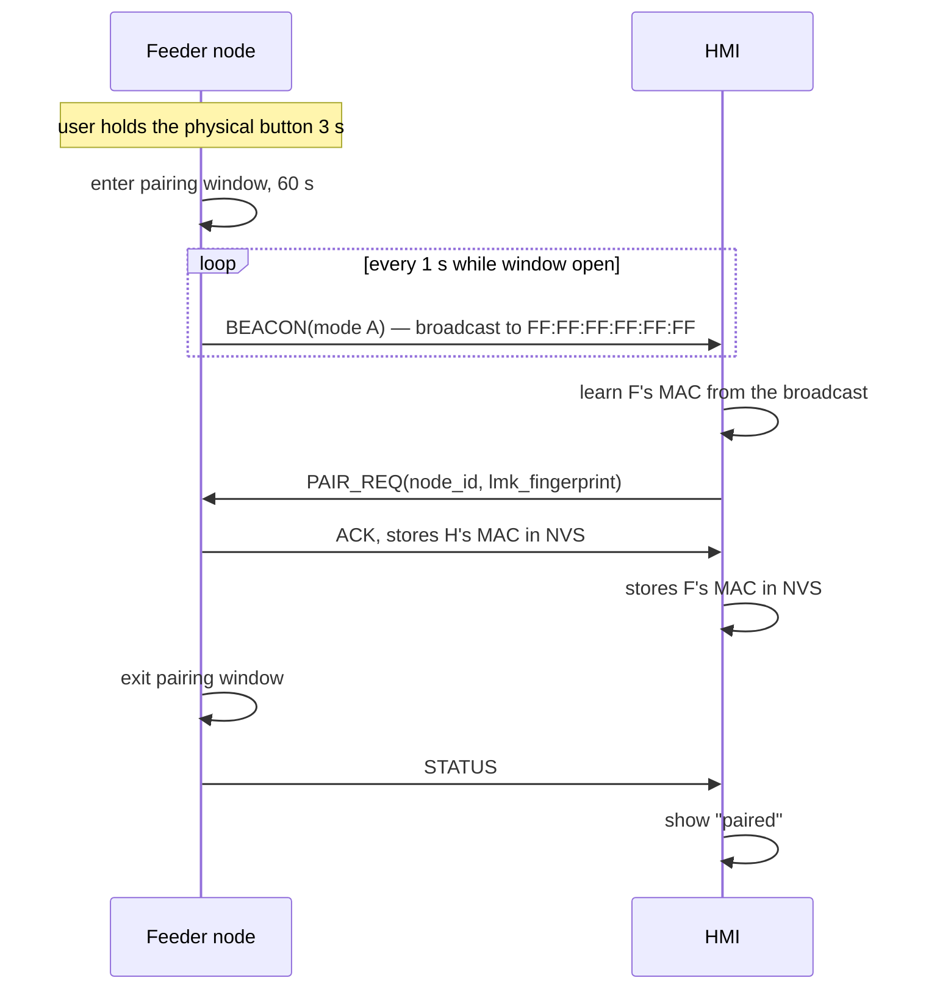

# 07 — Wireless protocol (ESP-NOW)

Both firmwares implement this document. If they disagree, fish go unfed. Treat it as a contract:
changes require a protocol version bump, and both apps get reflashed together.

## Protocol history

| Version | Byte | Change |
| --- | --- | --- |
| 1.0 | `0x10` | The original framing, packet catalogue, and test vectors 1–9. |
| 1.1 | `0x11` | Additive, per the rules below: new downlink `SET_CONFIG` (`0x16`), new
uplink `LOG_ENTRY` (`0x94`) for history reconciliation, and a 4-byte config
tail on `STATUS`. A 1.1 decoder reads 1.0 frames; a 1.0 decoder ignores the
1.1 additions (trailing bytes are ignored by design). Both firmwares in this
repo speak 1.1. |

## ESP-NOW in one paragraph

ESP-NOW is Espressif's connectionless 2.4 GHz peer-to-peer protocol. No router, no association, no
DHCP, no IP layer — you address a peer by MAC address and send up to **250 bytes**. Each frame gets a
link-layer acknowledgement, so you know whether it reached the peer's radio. What you do **not** get
is any application-level ordering, deduplication, or delivery guarantee: a frame can be lost, and a
retransmission can arrive after its own ack was lost. Everything below the fold exists to close that
gap.

## Two deployment modes

Pick one, and make both nodes agree. Mixing them is the classic ESP-NOW bug: the radios are on
different channels and nothing is ever delivered, with no error anywhere.

### Mode A — no router (recommended)

Both nodes sit on a **fixed channel**, `SAQ_ESPNOW_CHANNEL` (1, 6, or 11 — the non-overlapping ones).
Neither associates with an access point. Time comes from the HMI's PCF85063A via `SET_TIME`.

* Why it is recommended: nothing to configure in the field, nothing to break, no router to be down.
  It works in a shed with no WiFi at all.
* Cost: the HMI cannot reach the internet, so no NTP, no phone notifications.

### Mode B — with a router

The HMI associates with an access point for NTP and remote features. Both nodes must then operate on
**that AP's channel**.

* A station must follow its AP's channel, so ESP-NOW is forced onto the AP's channel too.
* The feeder node must be told the channel at runtime, over ESP-NOW, before anything else works.
  Chicken and egg: the bootstrap must happen on a shared default channel, then both switch.
* Read the actual channel at runtime (`esp_wifi_get_channel`), never assume. A router that
  re-selects its channel on reboot silently breaks the link.

If you do not specifically need internet features, take Mode A.

## Pairing

Neither node can talk to the other until it knows the peer's MAC address. That is the only
provisioning step.



Design decisions in that flow, and why:

* **Broadcast only while a physical button is held.** A node that beacons continuously can be paired
  by anyone in range. Requiring a physical press means pairing requires someone standing at the tank.
* **The window is 60 seconds and closes itself.** A pairing window that stays open forever is the same
  as no window.
* **Store both MACs in NVS**, in `saq_cfg.peer_mac`, so pairing survives a reboot.
* **An unpaired node still feeds.** Pairing is a provisioning step, not a gate on the schedule. Rule 1
  means the feeder node works before it has ever met the HMI.

### Encryption

ESP-NOW supports encryption with a PMK (primary master key) and per-peer LMK (local master key). Use
it: without it, anyone in radio range can forge a `FEED` command.

* The PMK and LMK are entered on the HMI and pushed to the feeder node during pairing, or compiled in
  as a device-family constant.
* Both sides must hold the **same** PMK and LMK, or every frame is silently dropped. There is no
  "wrong key" error — the frames just vanish. If pairing succeeds and delivery does not, suspect the
  keys before anything else.
* Encryption protects the payload, not the metadata. Sender and receiver MACs are visible on the air.
* Independently of encryption, the receiver should **filter by peer MAC** and discard anything from an
  unknown source. Cheap, and it stops stray ESP-NOW traffic from unrelated devices in the building.

## Frame format

Fixed 12-byte header, then a type-specific payload. Maximum total frame is 250 bytes, so payload is
capped at **238 bytes**.

| Offset | Size | Field | Notes |
| --- | --- | --- | --- |
| 0 | 1 | `magic` | `0xA5`. Anything else is discarded before parsing. |
| 1 | 1 | `version` | High nibble major, low nibble minor. This document describes **1.1** = `0x11`. Major must match; minor is informative. |
| 2 | 1 | `type` | See the packet catalogue. |
| 3 | 1 | `flags` | Bit 0 `ACK_REQUIRED`, bit 1 `IS_RESPONSE`. Others reserved, must be 0. |
| 4 | 4 | `seq` | `u32` LE. Monotonically increasing per sender, per direction. |
| 8 | 4 | `epoch_s` | `u32` LE. Sender's Unix time. **0 means the sender's clock is unsynced** — informative, never authoritative. |
| 12 | n | `payload` | Type-specific, `n ≤ 238`. |

Rules:

* **Little-endian throughout.**
* **Encode with explicit offsets or `memcpy` per field.** Do not `memcpy` a C struct and hope the
  compiler laid it out the way you assumed — padding and alignment differ between the Xtensa cores and
  the host compiler running the unit tests. The host tests will catch this, but only if the codec is
  written to be portable in the first place.
* **Reject, never guess.** Unknown `magic`, unknown major version, or unknown `type` → drop the frame
  and count it. Do not attempt a best-effort parse.
* `version` minor may be ignored; **major must match.** A major mismatch means incompatible framing, so
  the correct behaviour is to drop and report rather than misinterpret.

## Packet catalogue

### Downlink — HMI → feeder node

| Type | Name | Flags | Payload | Purpose |
| --- | --- | --- | --- | --- |
| `0x10` | `FEED` | ACK_REQUIRED | `portion_g u16`, `forced_ms u16` | Feed now. `forced_ms` 0 means "use calibration". |
| `0x11` | `STOP` | ACK_REQUIRED | — | De-energise immediately. Always accepted. |
| `0x12` | `SET_TIME` | ACK_REQUIRED | `epoch_s u32`, `tz_offset i32` | Push the HMI's PCF85063A time. |
| `0x13` | `SET_SCHEDULE_ENTRY` | ACK_REQUIRED | `index u8`, `count u8`, `entry[8]` | Write one schedule slot. |
| `0x14` | `STATUS_REQ` | ACK_REQUIRED | `since_seq u32` | Ask for status and any log entries after `since_seq`. |
| `0x15` | `PAIR_REQ` | ACK_REQUIRED | `node_id u8` | Claim this feeder during a pairing window. |
| `0x16` | `SET_CONFIG` | ACK_REQUIRED | `ms_per_g u16`, `default_portion_g u16` | v1.1. Write the feeder's calibration and default portion (the guided calibration flow on the HMI). |

### Uplink — feeder node → HMI

| Type | Name | Flags | Payload | Purpose |
| --- | --- | --- | --- | --- |
| `0x80` | `ACK` | IS_RESPONSE | `ack_seq u32`, `result u8` | Acknowledges one downlink frame. |
| `0x81` | `NACK` | IS_RESPONSE | `ack_seq u32`, `reason u8` | Received but refused. |
| `0x90` | `STATUS` | — | see below | Periodic and on request. |
| `0x91` | `FEED_DONE` | — | `portion_g u16`, `actual_ms u16`, `trigger u8`, `result u8` | A feed finished. |
| `0x92` | `FAULT` | — | `code u16`, `detail u16` | Something is wrong. |
| `0x93` | `BEACON` | — | `node_id u8`, `fw_major u8`, `fw_minor u8`, `hopper_pct u8` | Broadcast during a pairing window only. |
| `0x94` | `LOG_ENTRY` | — | `log_seq u32`, `event_epoch u32`, `portion_g u16`, `actual_ms u16`, `trigger u8`, `result u8` (14 bytes) | v1.1. One retained log entry, replayed in response to `STATUS_REQ(since_seq)` so the HMI can reconcile history after being offline. |

`result` codes: `0x00` ok, `0x01` rejected-duration, `0x02` busy, `0x03` unsupported-type,
`0x04` bad-payload, `0x05` not-paired, `0x06` clock-unsynced.

`trigger` for `FEED_DONE`/`LOG_ENTRY`: `0x00` scheduled, `0x01` manual from HMI, `0x02` local button.

`result` for `FEED_DONE`/`LOG_ENTRY` (feed outcome, distinct from the ACK result codes):
`0x00` completed, `0x01` clamped by `MAX_FEED_MS`, `0x02` interrupted (reboot mid-feed),
`0x03` stopped by a `STOP` command.

`STATUS` payload:

| Offset | Size | Field |
| --- | --- | --- |
| 0 | 1 | `clock_conf` — 1 if synced since last boot |
| 1 | 1 | `sched_count` |
| 2 | 4 | `last_feed_epoch` (`u32`, 0 if never) |
| 6 | 1 | `hopper_pct` — 255 if unknown |
| 7 | 4 | `last_log_seq` (`u32`) — what the HMI should ask from next |
| 11 | 4 | `uptime_s` (`u32`) |
| 15 | 4 | `link_seq` (`u32`) — feeder's own outbound sequence |
| 19 | 2 | `ms_per_g` (`u16`) — v1.1 tail: current calibration |
| 21 | 2 | `default_portion_g` (`u16`) — v1.1 tail |

The v1.0 payload is the first 19 bytes; v1.1 sends 23. A decoder must accept
both (ignore trailing bytes), which is what makes the tail an additive change.

`hopper_pct` of 255 means "no sensor fitted" rather than 0. Distinguishing unknown from empty matters:
a UI that shows "0%" for a missing sensor trains the user to ignore the field.

## Sequence numbers, retries, dedupe

**Sending.** Each sender maintains its own monotonically increasing `seq` per direction. Retransmitting
a frame **reuses the same `seq`** — that is what makes dedupe possible on the far end.

```
send(frame):
  attempts = 0
  while attempts < 3:
    transmit(frame)
    if wait_for_ack(frame.seq, timeout=250ms): return OK
    attempts += 1
    backoff(250ms * attempts)          # 250, 500
  return TIMEOUT
```

**Receiving.** The receiver keeps a window of the last **8** accepted `seq` values.

* `seq` already in the window → **do not act on it**; re-send `ACK` and discard. This is the case that
  prevents a double feed when an ack is lost.
* `seq` older than the window → discard silently.
* Otherwise → act, then `ACK`.

The window is 8 rather than 1 because frames can arrive out of order after retries. A single
"last seq" value would drop a legitimately-delayed `SET_SCHEDULE_ENTRY` that followed a retry.

**`STOP` is special.** It is idempotent, so it is never deduped away: a repeated `STOP` always
de-energises and always ACKs. The cost of acting twice on a stop is zero; the cost of ignoring a real
stop is a flooded tank.

## Loss of link

| Condition | Feeder node | HMI |
| --- | --- | --- |
| No ACK after 3 attempts | Logs `TX_TIMEOUT`, keeps its own state unchanged | Shows the command as failed — **never as succeeded** |
| No STATUS for 3 intervals | Continues feeding on its schedule | Marks the node offline; shows last-known status with a timestamp and a visible stale marker |
| Link lost mid-feed | Feed completes; `FEED_DONE` is queued for the next successful send | Shows "feed running, status unconfirmed" |
| Rebooted while unpaired | Feeds on schedule regardless | Pairing prompt on `Settings` |

The rule underneath the table: **the feeder node never waits for permission to feed, and the HMI never
claims an outcome it has not seen confirmed.** A UI that shows a green tick for a feed that never
happened is worse than one that shows a question mark.

## Worked example — a `FEED` frame

A manual feed of 3 g, sent as the 42nd downlink frame, at Unix time `1735689600`
(2025-01-01T00:00:00Z), ACK required:

```
Field          Value         Bytes (LE)
-------------  ------------  ---------------------------
magic          0xA5          A5
version        1.0          10
type           FEED         10
flags          ACK_REQUIRED  01
seq            42           2A 00 00 00
epoch_s        1735689600    80 85 74 67
portion_g      3             03 00
forced_ms      0             00 00
```

Complete frame, 16 bytes (12-byte header + 4-byte payload):

```
A5 10 10 01 2A 00 00 00 80 85 74 67 03 00 00 00
```

The expected reply, `ACK` for `seq` 42 with `result` 0, as the feeder's first uplink frame
(`seq` = 1), echoing its own clock, 17 bytes:

```
A5 10 80 02 01 00 00 00 80 85 74 67 2A 00 00 00 00
```

(flags `0x02` = IS_RESPONSE, payload `ack_seq` 42, `result` 0.)

## Test vectors

Encode these in the host tests in `components/smartaqua_protocol`. They are the contract; if a codec
change breaks one of these, the change is wrong or the version needs bumping.

| # | Packet | Input | Expected bytes |
| --- | --- | --- | --- |
| 1 | `FEED` | seq 42, epoch 1735689600, 3 g, forced 0 | `A5 10 10 01 2A 00 00 00 80 85 74 67 03 00 00 00` |
| 2 | `STOP` | seq 43, epoch 1735689601 | `A5 10 11 01 2B 00 00 00 81 85 74 67` |
| 3 | `ACK` | seq 1, epoch 1735689600, ack_seq 42, result 0 | `A5 10 80 02 01 00 00 00 80 85 74 67 2A 00 00 00 00` |
| 4 | `ACK`, no clock | seq 1, epoch 0, ack_seq 42, result 0 | `A5 10 80 02 01 00 00 00 00 00 00 00 2A 00 00 00 00` |
| 5 | `STATUS` | seq 7, epoch 1735689600, clock_conf 1, sched 4, last feed 1735603200, hopper 80, log 12, uptime 3600, link_seq 7 | `A5 10 90 00 07 00 00 00 80 85 74 67 01 04 00 34 73 67 50 0C 00 00 00 10 0E 00 00 07 00 00 00` |
| 6 | Reject | bad magic `B4 10 10 01 ...` | decode returns `MAGIC_MISMATCH` |
| 7 | Reject | major version `0x20` → byte 1 = `20` | decode returns `VERSION_MISMATCH` |
| 8 | Reject | unknown type `0x77` | decode returns `UNKNOWN_TYPE` |
| 9 | Dedupe | `FEED` seq 42 delivered twice | feeds once, ACKs twice |
| 10 | `SET_CONFIG` | seq 44, epoch 1735689600, 6000 ms/g, default 3 g | `A5 11 16 01 2C 00 00 00 80 85 74 67 70 17 03 00` (16 bytes) |
| 11 | `LOG_ENTRY` | seq 8, epoch 1735689600, log_seq 13, event 1735603200, 3 g, 18000 ms, scheduled, completed | `A5 11 94 00 08 00 00 00 80 85 74 67 0D 00 00 00 00 34 73 67 03 00 50 46 00 00` (26 bytes) |
| 12 | `STATUS` v1.1 | vector 5's fields plus 6000 ms/g and 3 g default | `A5 11 90 00 07 00 00 00 80 85 74 67 01 04 00 34 73 67 50 0C 00 00 00 10 0E 00 00 07 00 00 00 70 17 03 00` (35 bytes) |

Byte counts, so a codec bug is obvious at a glance: vector 1 = 16, vector 2 = 12 (a `STOP` is
header-only — there is no payload to count), vectors 3 and 4 = 17, vector 5 = 31 (the `STATUS`
payload is the full 19 bytes of the table above, `link_seq` included), vector 10 = 16, vector 11 = 26
(a 14-byte payload), vector 12 = 35 (a 23-byte payload). Vector 4 exists to pin down
that **epoch 0 decodes as "clock unsynced", not as an error** — a receiver that rejects a zero
timestamp would refuse every frame from a node that has just booted, which is exactly when you most
want to talk to it.

Vectors 1–9 are pinned at v1.0 (`0x10`) exactly as originally published; vectors 10–12 are the
v1.1 additions. All of them run in the boot-time self-test of both firmwares and in
`scripts/run_host_tests.sh`.

Every one of these is testable with no board attached. That is the point of keeping the codec in
`components/` with no IDF dependency — see
[08-testing-and-bringup.md](08-testing-and-bringup.md).

## Changing the protocol

1. Adding a packet type or a new field at the end of an existing payload → bump the **minor** version.
   Old peers can still parse frames they understand, if the decoder is written to ignore trailing
   bytes. Write it that way.
2. Changing a field's meaning, size, or position, or removing one → bump the **major** version, and add
   a `BREAKING CHANGE` footer to the commit. Both apps must be reflashed together.
3. Update this document, the byte tables, **and the test vectors** in the same PR. A protocol change
   without updated test vectors is an unfinished change.
4. Bump `SAQ_PROTO_VERSION` in `components/smartaqua_protocol`. A node that receives a major mismatch
   should surface a firmware-mismatch fault on the HMI rather than failing silently — that turns a
   half-hour debugging session on a ladder into a screen that says what is wrong.
