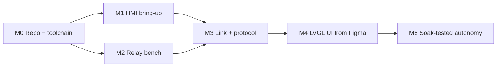

# 09 — Roadmap and milestones

Six milestones. Each has a goal, a deliverable, and acceptance criteria that are **observable on
hardware** — not "code written". A milestone is done when you can watch the thing work.

Work them in order. M1 and M2 are deliberately independent of each other, so if you are waiting on a
part you can switch tracks.

## Definition of done

Applies to every milestone. A milestone is not complete until all of these hold.

* Acceptance criteria below are all ticked, verified on real hardware
* Any relevant test in the bench matrix in
  [08-testing-and-bringup.md](08-testing-and-bringup.md#bench-test-matrix) passes
* CI green for both targets
* Host unit tests pass for anything in `components/`
* `docs/` updated for anything this milestone changed — especially pin numbers and versions
* The change reached `main` through a reviewed, squashed PR
* Anything you learned that contradicts these docs is written down, not just remembered

---

## M0 — Repository and toolchain proven

**Goal:** a new machine can be set up and both firmware targets built by following
[03-toolchain-setup.md](03-toolchain-setup.md), with no tribal knowledge.

**Deliverable:** the repo as it stands, plus a successful local build of both apps.

**Acceptance criteria**

- [ ] `git clone` on a clean machine, then the setup doc, produces a working `idf.py`
- [ ] `cd apps/hmi && idf.py set-target esp32s3 && idf.py build` succeeds
- [ ] `cd apps/feeder && idf.py set-target esp32 && idf.py build` succeeds
- [ ] CI runs both builds on push and on PR
- [ ] The HMI's generated `sdkconfig` shows 16 MB flash, octal PSRAM, USB-Serial-JTAG console
- [ ] Both boards enumerate a COM port, and the ports are recorded in the README

**Not required:** any application behaviour. The `app_main` banner is enough.

**Risk:** none worth naming. This milestone exists to remove setup friction before it can be confused
with a firmware bug.

---

## M1 — HMI bring-up

**Goal:** the S3 board is a known quantity — display, touch, RTC, and expander all verified.

**Deliverable:** a `apps/hmi` that initialises the panel, runs an LVGL screen, and reads the RTC.

**Acceptance criteria**

- [ ] Panel resolution settled (800 × 480 or 1024 × 600) and recorded in
      [02-hardware-and-wiring.md](02-hardware-and-wiring.md), with the config value that matches
- [ ] Panel controller identified (ST7262 or ST7701) and recorded
- [ ] A full-screen LVGL screen renders with no tear and no drift over 10 minutes
- [ ] A touch anywhere on the screen reports coordinates that match where you pressed, within a few pixels
- [ ] The RTC reads a correct time, and still does after a power cycle
- [ ] Whether any CH422G expander pin is reachable is resolved, and the answer is recorded
- [ ] LVGL 8.4 is running through `esp_lvgl_port` (or the vendor port), with the lock/unlock discipline
      from [06-ui-design-workflow.md](06-ui-design-workflow.md#working-with-the-lvgl-task) followed
- [ ] Free heap and PSRAM logged at boot and after 10 minutes, with no downward trend

**Blocks:** M4 (you cannot lay out a UI without knowing the panel size).

**Risks:** the two vendor pin-data ambiguities — panel controller and resolution. Both are resolved in
step 0 of the bring-up doc, in ten minutes, with the prebuilt binaries. Do that before writing code.

---

## M2 — Feeder relay bench-verified

**Goal:** the motor switches, and every failure mode switches it **off**.

**Deliverable:** `apps/feeder` that drives the relay safely, with the duration clamp in place.

**Acceptance criteria**

- [ ] Relay is silent during reset and boot — no click, meter-confirmed off
- [ ] Relay de-energises on power loss while energised
- [ ] Relay de-energises on a deliberate firmware crash while energised
- [ ] Hard `MAX_FEED_MS` clamp enforced and tested with an absurd requested duration
- [ ] No ESP32 reset when the motor starts, in the real enclosure, with the hopper loaded
- [ ] No ESP32 reset when the motor stops (flyback verified)
- [ ] Portion calibration stored in NVS, and a 3 g request weighs within ±10%
- [ ] `feed_in_progress` crash-safety flag implemented; a mid-feed reboot does not re-feed

**Blocks:** nothing, but everything in M5 depends on it.

**Risks:** this is where the electrical design gets tested, and the most likely outcome is discovering
that the motor supply needs decoupling or the relay needs a snubber. Budget time for that; it is
normal, not a setback.

---

## M3 — Wireless link and protocol

**Goal:** the two boards talk, reliably, and know what to do when they cannot.

**Deliverable:** `components/smartaqua_protocol` with host tests, ESP-NOW transport in both apps,
pairing.

**Acceptance criteria**

- [ ] Every test vector in [07-wireless-protocol.md](07-wireless-protocol.md#test-vectors) passes as a
      host unit test, on a machine with no board attached
- [ ] Codec rejects bad magic, major-version mismatch, unknown type, truncated and oversized payloads
- [ ] Dedupe window: a duplicate `FEED` feeds once and ACKs twice
- [ ] `STOP` is never deduped away and always acts
- [ ] Pairing requires a physical button press; the window closes by itself
- [ ] Unpaired feeder still feeds on its schedule (rule 1)
- [ ] Peer MAC filtering drops frames from unknown senders
- [ ] ESP-NOW encryption enabled, with a documented key provisioning path
- [ ] Channel mode chosen and documented (Mode A or Mode B)
- [ ] Range established with the HMI inside the real enclosure; margin recorded
- [ ] `STATUS` arrives on the HMI at the expected interval
- [ ] The HMI never reports a feed it has not seen ACKed

**Blocks:** M4 (screens display live state) and M5.

**Risks:** the silent-failure modes. A wrong channel or a wrong key produces zero delivery and no
error. Test on a bench where you can change one variable at a time.

---

## M4 — LVGL UI built from Figma

**Goal:** a person can schedule and run a feed from the touchscreen.

**Deliverable:** the six screens from [06-ui-design-workflow.md](06-ui-design-workflow.md#screen-inventory),
implemented, with the design system in place.

**Acceptance criteria**

- [ ] Figma file has one frame per screen at exactly the panel size, verified in step 0
- [ ] All colours and spacing trace to tokens in `design/tokens.md`; no stray hex literals outside
      `ui_theme.h`
- [ ] Fonts chosen and generated with trimmed glyph ranges; flash cost recorded
- [ ] Every interactive element is ≥ 44 × 44 px
- [ ] Every screen implements **empty**, **loading**, **error**, and **link-lost** states — not just the
      happy path
- [ ] Contrast checked numerically (4.5:1 body, 3:1 large/UI)
- [ ] `Home` shows clock confidence when unsynced, as a visible warning
- [ ] `FeedNow` requires explicit confirmation before any feed
- [ ] `History` reconciles from the feeder node after a simulated outage
- [ ] On-device screenshot of each screen reviewed side by side against its Figma frame
- [ ] No LVGL object touched from another task without the lock

**Depends on:** M1 (panel size), M3 (live state).

**Risks:** the UI is the largest surface area and the easiest place to accrue unreviewed work. Keep each
screen its own PR with its own screenshot, so a regression is attributable.

---

## M5 — Autonomous, soak-tested feeding

**Goal:** the feeder can be trusted with fish while nobody is watching.

**Deliverable:** a system that has run unattended through a real schedule for a week.

**Acceptance criteria**

- [ ] The feeder node feeds on its own schedule with the HMI powered off, across a full week
- [ ] The HMI reconciles history correctly after being offline for at least 24 hours
- [ ] Clock holds correct time across a full week, including at least one power cut
- [ ] An unsynced clock is surfaced to the user, not silently tolerated
- [ ] OTA works for both apps, and a power loss mid-OTA leaves the old image bootable
- [ ] Memory (heap and PSRAM) shows no downward trend over 7 days
- [ ] No feed fired twice and none was missed, across the whole period
- [ ] Mechanical backstop fitted (shear pin, slip clutch, or physical stop) — see
      [02-hardware-and-wiring.md](02-hardware-and-wiring.md#safety)
- [ ] Portion accuracy still within ±10% at the end of the week
- [ ] Every item in the [release checklist](08-testing-and-bringup.md#release-checklist) ticked
- [ ] `hmi/v1.0.0` and `feeder/v1.0.0` tagged, with binaries attached to GitHub Releases

**Depends on:** everything.

**Risks:** the soak test is the only step that finds the bugs that matter, and it cannot be shortened.
If you compress it, you are choosing to discover those bugs with fish in the tank instead of with a
dummy load on the bench.

---

## Sequencing at a glance

M1 and M2 are parallel. Everything after them is a chain, because the UI needs live state and the soak
needs all of it.

## Deliberately not planned yet

Named so they are not accidentally assumed to be in scope:

* **Hopper level sensing.** The protocol reserves `hopper_pct` with a 255 "unknown" sentinel precisely
  so a sensor can be added without a breaking change.
* **Remote access from a phone.** Mode B WiFi plus MQTT. Useful, but not needed for the feeder to work,
  and it is a new attack surface to design for.
* **Multiple feeder nodes.** The protocol has `node_id` and per-frame addressing, so this is a
  configuration change rather than a redesign — but it is not planned.
* **Camera or feeding-activity detection.** Genuinely nice, genuinely a different project.
